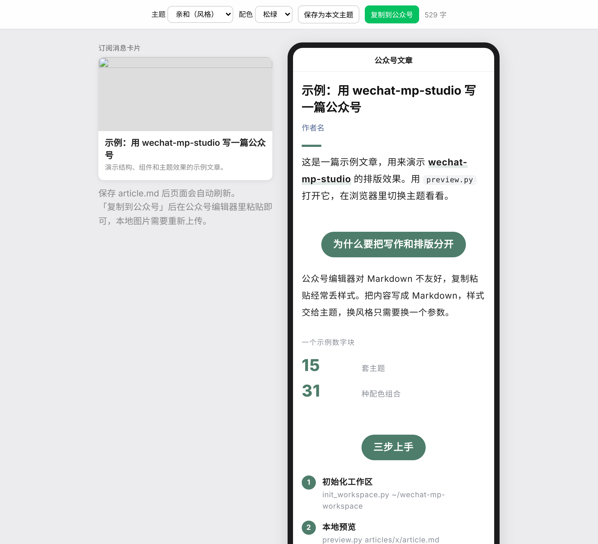
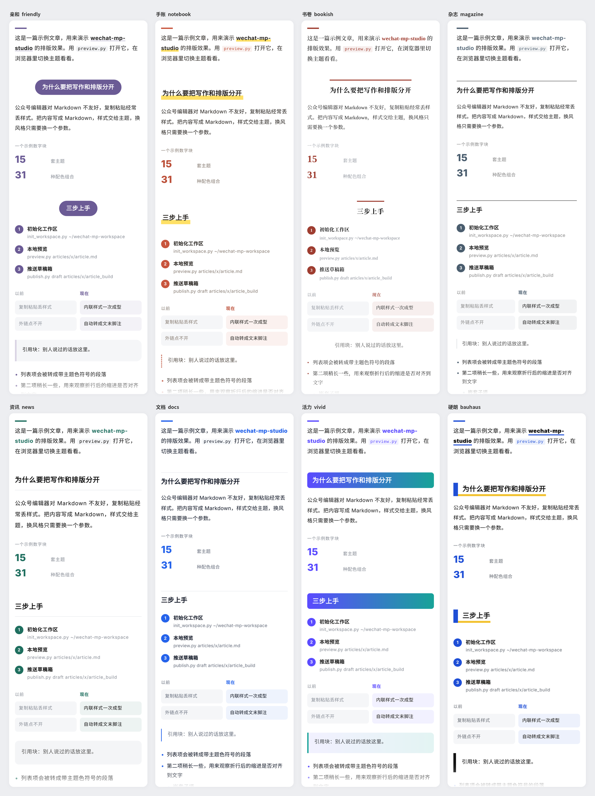

# wechat-mp-studio

[中文](README.md) · English

A Claude skill for **writing, formatting, previewing and publishing WeChat Official Account (公众号) articles** — entirely on your own machine.

- ✍️ **Write** — 7 article structure templates, a personal style profile, automatic review (typos, sensitive words, "AI tone")
- 🎨 **Format** — Markdown → WeChat-safe inline-styled HTML; 15 themes (7 base + 8 styles × 3 color schemes)
- 🧩 **Components** — callouts, lead, stat cards, quote card, compare, steps, checklist, author card, footer QR
- 👀 **Local live preview** — phone-width preview in your browser, switch theme/scheme, auto-reload on save, one-click copy into the WeChat editor
- 🚀 **Publish** — automatic image upload & compression, push to the draft box, optional direct publish, multiple accounts



## Install

### Option 1 — Claude Code plugin (recommended)

Inside Claude Code:

```
/plugin marketplace add encoreshao/wechat-mp-studio
/plugin install wechat-mp-studio@wechat-mp-studio
```

Then install the Python deps and tell Claude "**initialize my WeChat workspace**" — it runs the bundled `init_workspace.py` to create a workspace for your articles and config (default `~/wechat-mp-workspace`):

```bash
pip3 install markdown beautifulsoup4 pillow
```

### Option 2 — Claude Code, manual

```bash
git clone https://github.com/encoreshao/wechat-mp-studio.git
cd wechat-mp-studio
./install.sh --workspace ~/wechat-mp-workspace   # symlink into ~/.claude/skills + create a workspace
```

### Option 3 — Claude app (claude.ai / desktop / Cowork)

1. Download `wechat-mp-studio.zip` from [Releases](https://github.com/encoreshao/wechat-mp-studio/releases) (or run `./package.sh` to build it into `dist/`).
2. Open **Customize → Skills**, click **+ → Upload a skill**, and pick the zip.
3. Make sure code execution / file creation is enabled under **Settings → Capabilities**.

> Writing and formatting work inside the app; **publishing and the local live preview must run on your own computer** (WeChat checks an IP whitelist) — use Claude Code, or let Cowork link to your computer.

## Usage

Ask Claude:

> 写一篇公众号：主题是 xxx，参考资料 https://…  (Write a WeChat article about xxx, sources: …)

Claude walks through **topic → outline → draft → review → format & preview → cover → draft box**, pausing for your confirmation at each step.

Or run the scripts yourself (inside your workspace):

```bash
S=~/.claude/skills/wechat-mp-studio/scripts
python3 $S/preview.py articles/2026-11-21-demo/article.md     # live local preview
python3 $S/convert.py --list-themes
python3 $S/convert.py articles/x/article.md --theme bookish --scheme 黛蓝
python3 $S/gallery.py articles/x/article.md --out gallery.html # compare every theme
python3 $S/cover.py --title 'Title\nSubtitle' --out articles/x/cover.jpg
python3 $S/publish.py draft articles/x/article_build --cover articles/x/cover.jpg
```

## Themes



Style themes: friendly, notebook, bookish, magazine, news, docs, vivid, bauhaus — each with 3 color schemes. Base themes: tech-blue, minimal-black, warm-orange, elegant-purple, fresh-green, business-navy, ink-red. Custom themes are JSON files in your workspace (`templates/themes/`), see [references/themes.md](skills/wechat-mp-studio/references/themes.md).

## Layout

```
.claude-plugin/              Claude Code plugin + marketplace manifests
skills/wechat-mp-studio/     ← the skill (install this folder)
  SKILL.md                   main workflow (lean; details live in references/)
  scripts/                   convert / preview / gallery / cover / publish / init_workspace
  references/                themes, components, writing, publishing, WeChat HTML constraints
  assets/structures/         article structure templates
  assets/workspace/          workspace template
examples/hello/              sample article
tests/                       pytest
install.sh / package.sh      manual install / build the upload zip
```

Your **workspace** (config with AppSecret — git-ignored —, articles, custom templates, style profile) is kept separate from the skill code and is found via `WECHAT_MP_WORKSPACE` or by running inside it.

## Publishing notes

- Requires a **verified** subscription/service account; get AppID/AppSecret under 设置与开发 → 基本配置 and whitelist your outbound IP (on error 40164 the script prints the IP WeChat saw).
- Default is draft box only. `freepublish` does **not** push to followers — use 群发 in the dashboard for that.
- See [references/publishing.md](skills/wechat-mp-studio/references/publishing.md).

## Credits

The 8 style presets and infographic component designs are adapted from [aiworkskills/wechat-article-skills](https://github.com/aiworkskills/wechat-article-skills) (Apache-2.0). See [NOTICE.md](NOTICE.md).

## License

[MIT](LICENSE) © Encore Shao
