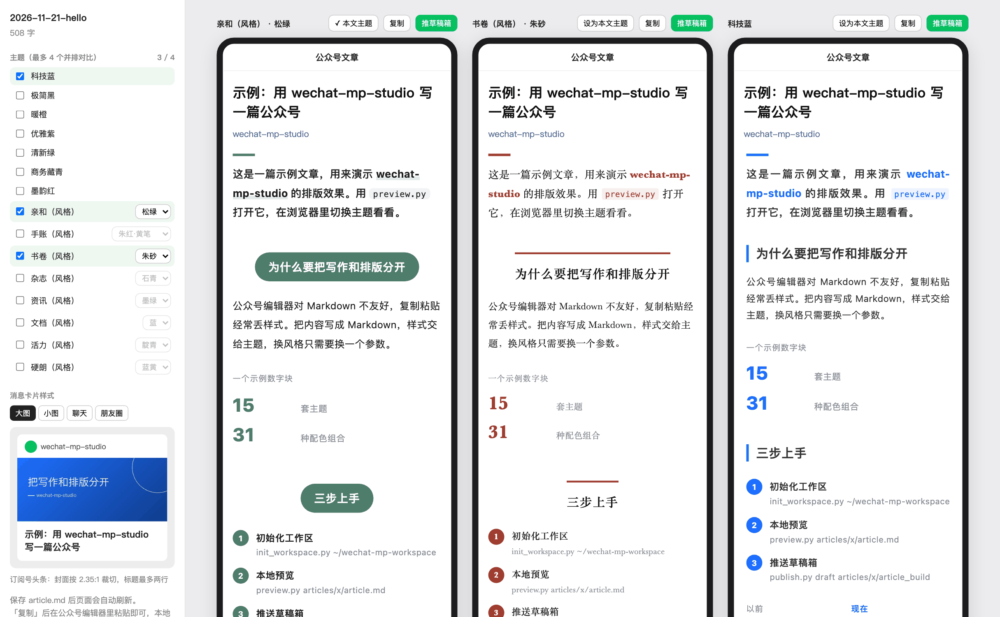
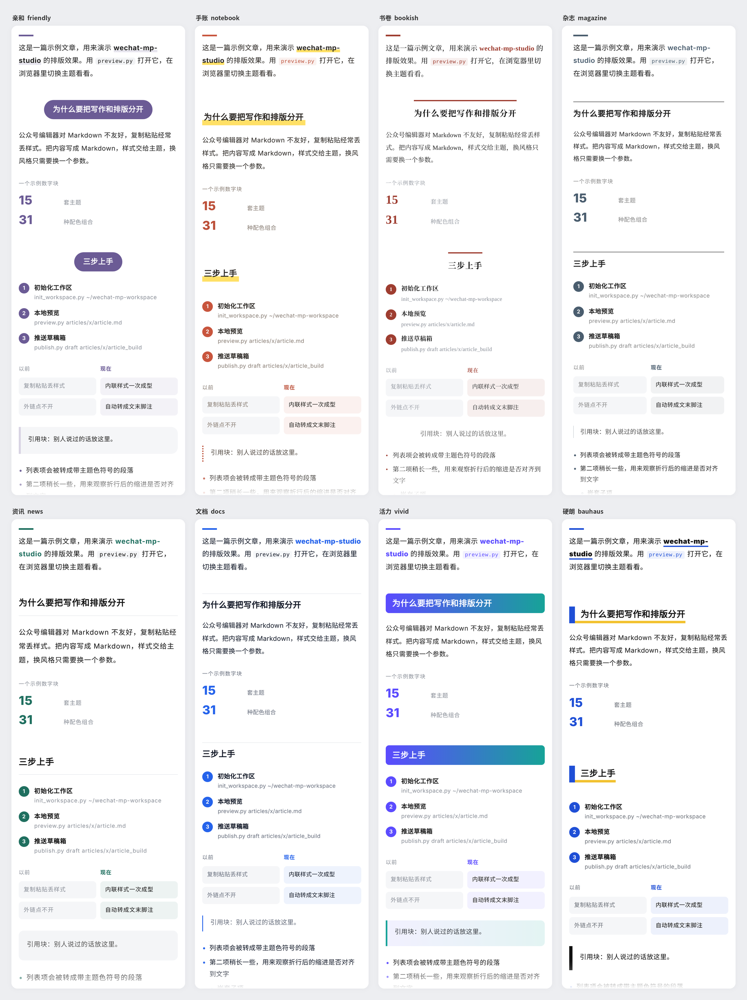

# wechat-mp-studio

中文 · [English](README.en.md)

一个 Claude skill：在你自己的电脑上完成**微信公众号文章的创作、排版、本地预览和发布**。

- ✍️ **创作**：7 套文章结构模版、写作风格档案、自动审校（错别字 / 敏感词 / AI 腔）
- 🎨 **排版**：Markdown → 公众号可用的内联样式 HTML；15 套主题（7 基础 + 8 风格 × 3 配色）
- 🧩 **组件**：提示框、导语、数据卡、金句卡、对比、步骤、清单、作者卡、页脚二维码
- 👀 **本地实时预览**：浏览器里手机宽度预览，最多 4 个主题/配色并排对比，检查订阅号/聊天/朋友圈卡片效果，保存即刷新，一键复制到公众号编辑器或推送草稿箱
- 🚀 **发布**：图片自动上传压缩，推送草稿箱，可选直接发布，多账号



## 安装

### 方式一：Claude Code 插件（推荐，一行命令、可自动更新）

在 Claude Code 里执行：

```
/plugin marketplace add encoreshao/wechat-mp-studio
/plugin install wechat-mp-studio@wechat-mp-studio
```

然后安装 Python 依赖，并在 Claude Code 里说一句「**初始化公众号工作区**」，Claude 会用 skill 自带的 `init_workspace.py` 创建工作区（你的文章和配置放这里，默认 `~/wechat-mp-workspace`）：

```bash
pip3 install markdown beautifulsoup4 pillow
```

### 方式二：Claude Code 手动安装（适合想改代码的人）

```bash
git clone https://github.com/encoreshao/wechat-mp-studio.git
cd wechat-mp-studio
./install.sh --workspace ~/wechat-mp-workspace   # 软链到 ~/.claude/skills，并创建工作区
```

### 方式三：Claude App（claude.ai / 桌面版 / Cowork）

1. 在 [Releases](https://github.com/encoreshao/wechat-mp-studio/releases) 下载 `wechat-mp-studio.zip`（或在仓库里运行 `./package.sh` 生成到 `dist/`）。
2. 打开 **Customize → Skills**，点 **+ → Upload a skill**，选择这个 zip。
3. 确保 **Settings → Capabilities** 里开启了「代码执行与文件创建」。

> 写作和排版在 App 里就能完成；**发布到公众号和本地预览需要在你自己的电脑上运行**（微信校验 IP 白名单），请用 Claude Code，或让 Cowork 连接你的电脑。

## 使用

在 Claude 里直接说：

> 写一篇公众号：主题是 xxx，参考资料 https://…

Claude 会按 **选题 → 大纲 → 写作 → 审校 → 排版预览 → 封面 → 草稿箱** 逐步推进，每一步都等你确认。

也可以手动使用脚本（在工作区目录内）：

```bash
S=~/.claude/skills/wechat-mp-studio/scripts
python3 $S/preview.py articles/2026-11-21-demo/article.md          # 本地实时预览
python3 $S/convert.py --list-themes                                 # 主题列表
python3 $S/convert.py articles/x/article.md --theme bookish --scheme 黛蓝
python3 $S/gallery.py articles/x/article.md --out gallery.html      # 全主题对比
python3 $S/cover.py --title '主标题\n副标题' --out articles/x/cover.jpg
python3 $S/publish.py draft articles/x/article_build --cover articles/x/cover.jpg
```

## 主题



| 风格主题 | 适合 |
|---|---|
| 亲和 friendly | 教程、新手向 |
| 手账 notebook | 个人笔记、复盘 |
| 书卷 bookish | 人文、深度长文 |
| 杂志 magazine | 品牌故事、访谈 |
| 资讯 news | 快讯、行业观察 |
| 文档 docs | 技术文档、代码讲解 |
| 活力 vivid | 产品发布 |
| 硬朗 bauhaus | 观点、宣言 |

另有 7 套基础主题：科技蓝、极简黑、暖橙、优雅紫、清新绿、商务藏青、墨韵红。可在工作区 `templates/themes/` 用 JSON 自定义（见 [references/themes.md](skills/wechat-mp-studio/references/themes.md)）。

## 目录结构

```
.claude-plugin/              Claude Code 插件与 marketplace 清单
skills/wechat-mp-studio/     ← skill 本体（安装这个文件夹）
  SKILL.md                   主流程（精简，细节按需读 references/）
  scripts/                   convert / preview / gallery / cover / publish / init_workspace
  references/                主题、组件、写作、发布、微信 HTML 约束
  assets/structures/         文章结构模版
  assets/workspace/          工作区模板
examples/hello/              示例文章
tests/                       pytest
tools/                       开发用脚本（重新生成 README 截图）
install.sh / package.sh      手动安装 / 打包上传用 zip
```

**工作区**（你的数据）与 skill 代码分开：`config.json`（含 AppSecret，已 gitignore）、`articles/`、自定义模版、风格档案。通过 `WECHAT_MP_WORKSPACE` 环境变量或在工作区目录内运行来识别。

## 发布须知

- 需要**已认证**的订阅号/服务号；在「设置与开发 → 基本配置」获取 AppID/AppSecret，并把出口 IP 加入白名单（报错 40164 时脚本会显示微信看到的 IP）。
- 默认只推草稿箱。`freepublish` 直接发布**不会推送给粉丝**，要推送请在后台群发。
- 详见 [references/publishing.md](skills/wechat-mp-studio/references/publishing.md)。

## 致谢

8 套风格主题与信息图组件的设计改编自 [aiworkskills/wechat-article-skills](https://github.com/aiworkskills/wechat-article-skills)（Apache-2.0），详见 [NOTICE.md](NOTICE.md)。

## License

[MIT](LICENSE) © Encore Shao
